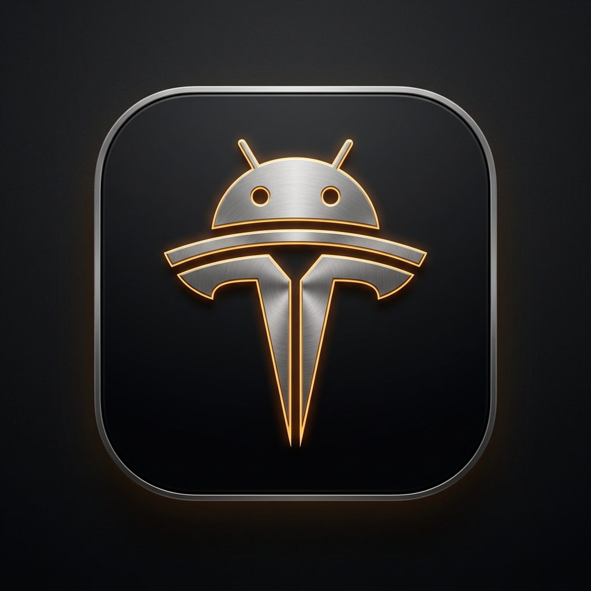
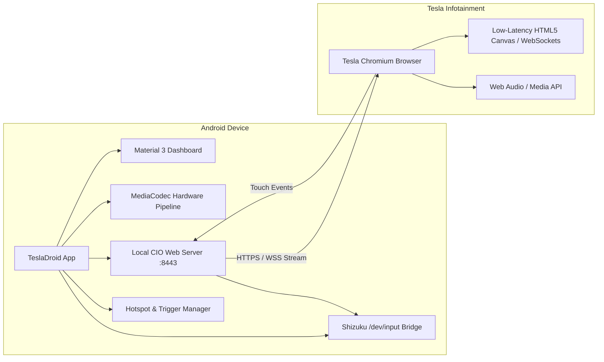

# TeslaDroid

<p align="center">
  
  <br>
  <b>Mirror Android apps to your Tesla infotainment center screen with low latency & bi-directional multi-touch.</b>
</p>

<p align="center">
  <a href="https://github.com/tesladroid11/tesla-droid-app/releases/latest"></a>
  <a href="https://github.com/tesladroid11/tesla-droid-app/releases"></a>
  <a href="https://www.patreon.com/cw/TeslaDroidApp"></a>
  <a href="https://android.com"></a>
  <a href="LICENSE"></a>
  <a href="https://github.com/tesladroid11/tesla-droid-app/stargazers"></a>
</p>

<p align="center">
  <a href="https://tesla-droid.app"><b>🌐 Official Website</b></a> •
  <a href="https://github.com/tesladroid11/tesla-droid-app/releases/download/v1.0.0/TeslaDroid-v1.0.0.apk"><b>📥 Direct APK Download</b></a> •
  <a href="https://www.patreon.com/cw/TeslaDroidApp"><b>❤️ Support on Patreon</b></a> •
  <a href="#-quick-start-guide"><b>🚀 Quick Start</b></a> •
  <a href="#-support--donations"><b>💰 Crypto Wallets</b></a>
</p>

---

> [!TIP]
> **TeslaDroid is 100% Free & Open-Source with Zero Monetization.**  
> No subscriptions, no ads, no telemetry. If TeslaDroid elevates your drive, please consider **[★ Starring the Repository](https://github.com/tesladroid11/tesla-droid-app/stargazers)** and **[Supporting on Patreon](https://www.patreon.com/cw/TeslaDroidApp)** to help fund test hardware and reverse-engineering against new Tesla firmware releases!

---

**TeslaDroid** is an advanced, standalone Android vehicle integration and display streaming solution engineered specifically for Tesla infotainment screens. Utilizing Tesla's built-in Chromium browser, TeslaDroid delivers a high-definition, ultra-low-latency feed of Android apps with full bi-directional multi-touch support, uncompressed audio streaming, intelligent network automations, advanced cyber-navigation protection, and multimodal voice assistance.

---

## 🚗 Supported Vehicles

| Model | Compatibility | Notes |
| :--- | :--- | :--- |
| **Tesla Model 3** | ✅ Fully Supported | All years (Intel Atom & AMD Ryzen) |
| **Tesla Model Y** | ✅ Fully Supported | All years (Intel Atom & AMD Ryzen) |
| **Tesla Model S** | ✅ Fully Supported | MCU2 (2018+) & MCU3 (Plaid) |
| **Tesla Model X** | ✅ Fully Supported | MCU2 (2018+) & MCU3 (Plaid) |
| **Tesla Cybertruck** | ✅ Fully Supported | Fullscreen touch & audio |

---

## ⚡ Key Features

### 🎮 Ultra Low-Latency Display Engine
- **Hardware-Accelerated Encoding**: Native `MediaCodec` pipeline leveraging H.264 and HEVC (H.265) hardware encoders.
- **Bi-Directional Touch Input**: Direct touch and multi-touch gesture injection via privileged system services (`/dev/input` through Shizuku). No root required.
- **Adaptive Bitrate & Frame Rate**: Dynamic video stream configurations from 4 Mbps up to 20 Mbps, supporting 20, 30, 40, and 60 FPS refresh rates.
- **Display Density Tuning**: Custom virtual display DPI scaling (160 to 400 DPI) for optimal app layout and interface sharpness on Tesla's center touchscreen.

### 🚘 Intelligent Driving Automations
- **Dual Connection Triggers**:
  - **Bluetooth Trigger**: Automatically launches the stream upon connecting to your Tesla's Bluetooth and gracefully shuts down after 30 seconds of disconnection.
  - **Wi-Fi Trigger**: Automatically activates when connecting to a designated Wi-Fi network (such as a secondary hotspot or in-vehicle router).
- **Automated Mobile Hotspot**: Automatically activates your phone's Wi-Fi hotspot upon session launch and turns it off when streaming terminates.
- **OLED Battery & Thermal Saver**: Independent screen dimming overlay allows the phone's physical display to stay dark while streaming continuously to the vehicle.

### 🔊 Studio Audio Routing
- **Dual Audio Architecture**:
  - **Direct Tesla Bluetooth**: Zero-delay high-fidelity sound directly routed through the car's Bluetooth audio channel.
  - **Web Audio (PCM / Opus)**: Stream uncompressed 16-bit PCM audio or bandwidth-efficient Opus audio directly inside the Tesla browser session.
- **Audio-Video Synchronization**: Fine-grained sub-second audio sync adjustment (0–300 ms delay compensation).

### 🛰️ GPS Shield (Anti-Jamming & Spoofing Protection)
- **Advanced Navigation Cybersecurity**: Safeguards navigation applications (Waze, Google Maps) against satellite signal anomalies, electronic jamming, and GPS spoofing attacks.
- **Dynamic Fused Fallback**: Continuously monitors satellite signal integrity. When anomalies, spoofed coordinate jumps, or RF interference are detected, the system immediately transitions navigation apps to fused cellular network and Wi-Fi positioning.
- **Seamless Recovery**: Automatically transitions back to high-precision satellite positioning once clean signals are restored, maintaining uninterrupted turn-by-turn route guidance.

### 🤖 Multimodal AI In-Cabin Assistant
- Direct integration with Google Gemini live multimodal voice assistants.
- Hands-free wake word activation ("Hey Tesla") with animated edge glow visual effects.
- Floating in-browser assistant button for rapid voice commands and vehicle control.

---

## 🏗️ Architecture Overview



---

## 🚀 Quick Start Guide

### Prerequisites
1. An Android phone running **Android 10 (API 29)** or newer.
2. [Shizuku](https://shizuku.rikka.app/) installed and running via Wireless Debugging or root.
3. Tesla vehicle running firmware with Chromium-based browser support.

### Setup Instructions

1. **Start Shizuku**:
   - Open Shizuku on your phone.
   - Start Shizuku via **Wireless Debugging** (in Developer Options) or Root.
   - Grant permission to **TeslaDroid**.

2. **Network Connection**:
   - Turn on your phone's Wi-Fi hotspot (WPA2 personal recommended).
   - In your Tesla, connect the vehicle Wi-Fi to your phone's hotspot and check **Remain connected in Drive**.

3. **Open the Vehicle Browser**:
   - Launch the browser on your Tesla center screen.
   - Enter the URL displayed at the top of TeslaDroid (or use the 6-character short code `https://car.tesla-droid.app/xxxxxx`).
   - Bookmark the page in your car's browser for instant future access.

4. **Enjoy Seamless Mirroring**:
   - Touch input, audio, and navigation mirror directly with full responsiveness.

---

## 🛠️ Building from Source

TeslaDroid is built using modern Android Gradle build tools.

```bash
# Clone the repository
git clone https://github.com/tesladroid11/tesla-droid-app.git
cd tesla-droid-app

# Build debug APK
./gradlew assembleDebug

# Install on connected device via ADB
./gradlew installDebug
```

---

## ❤️ Support & Donations

TeslaDroid is **100% free, community-driven, and open-source**. There are no paywalls, subscriptions, or telemetry. Your contributions directly fund test hardware, server bandwidth, and continuous reverse-engineering against new Tesla Chromium firmware releases.

### Patreon
Support ongoing development with monthly or one-time contributions:  
👉 **[Support on Patreon (TeslaDroidApp)](https://www.patreon.com/cw/TeslaDroidApp)**

### Cryptocurrency
| Currency | Network | Address |
| :--- | :--- | :--- |
| **USDT** | TRC-20 | `TFghs2UzVVTo8xLbe9aws2WBc8YvrNB8kW` |
| **Bitcoin** | Native SegWit | `bc1qj92ptfk7vahdm94vh805zgymxx2ggt6zn2rqat` |
| **Ethereum** | ERC-20 / Arbitrum | `0xb46e07cded28324b49086eb1aa2c2bea7654354d` |
| **Solana** | SOL | `7Hx5Q3uPN63NYMGCn214HxvnYQVxvafxLSQYEXPqFNuE` |

---

## 🌐 Community & Contact

- **Official Website**: [tesla-droid.app](https://tesla-droid.app)
- **Technical Support & Inquiries**: `tesladroid@proton.me`
- **Issue Tracker**: [GitHub Issues](https://github.com/tesladroid11/tesla-droid-app/issues)

---

## 🌟 Stargazers over time

[](https://star-history.com/#tesladroid11/tesla-droid-app&Date)

---

## 📄 License

TeslaDroid is licensed under the **Apache License, Version 2.0**. See the [LICENSE](LICENSE) file for more information.

---

## ⚠️ Disclaimer

*TeslaDroid is an independent open-source project and is not affiliated with, endorsed by, or sponsored by Tesla, Inc. or Google LLC. Always prioritize road safety and observe local driving laws while operating motor vehicles.*
